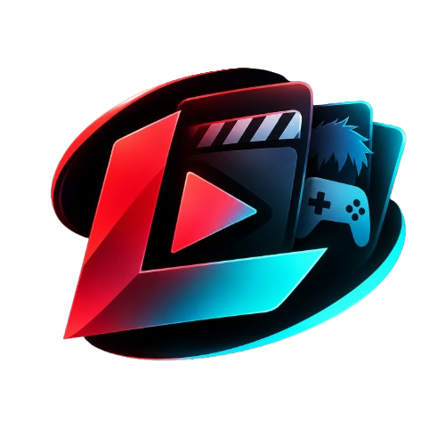

<div align="center">
  
  <h1>🎵🏷️ LierTags v1.1 — Fast Audio Tag & Cover Editor</h1>
  <p><strong>Local high-performance audio metadata, artwork, and lyrics editor built with Rust and Tauri 2</strong></p>

  <p>
    <a href="README.md"></a>
    <a href="README_EN.md"></a>
    <a href="https://github.com/LaRCorp/LierTags/releases"></a>
    
    
    <a href="LICENSE"></a>
    <a href="https://github.com/LaRCorp/LierEX-Q"></a>
    <a href="https://github.com/LaRCorp/Lierkour"></a>
    <a href="https://github.com/LaRCorp/LierSync"></a>
  </p>
</div>

**LierTags** is a local desktop application and CLI utility for reading, editing, searching, and organizing audio metadata. Built with **Rust** (`lofty`), **Tauri 2**, and **React 19**, it launches instantaneously and handles tens of thousands of tracks smoothly with minimal memory footprint.

---

## Key Features

- **Wide Format Support:** MP3 (ID3v1/v2), FLAC (Vorbis Comments), M4A / AAC / ALAC (MP4 Atoms), OGG Vorbis, Opus, WAV / AIFF, and APE.
- **Cover Art & Lyrics:** Embedded JPEG/PNG/WebP artwork preview, drag-and-drop & clipboard (`Ctrl+V`) cover replacement, Cover Art Archive downloads, and synchronized `.lrc` lyrics lookup via LRCLIB.
- **Virtualized UI & SQLite WAL Cache:** Smooth scrolling across 10,000+ tracks (`@tanstack/react-virtual`) backed by parallel `rayon` scanning and persistent SQLite indexing.
- **File Organizer & Duplicate Finder:** Pattern-based folder organization (`{artist}/{album}/{track:02} - {title}.{ext}`) and exact/metadata duplicate cleanup.
- **LIER Ecosystem Integration (v1.1):**
  - **Send to Phone / PC via LierSync (`:8768`):** Push checked tracks, the active track, or an entire music folder straight to paired devices over P2P.
  - **OST Tagging from Lierkour (`:8765`):** Pull movie, series, anime, or game titles, years, genres, and posters directly into soundtrack album tags.
  - **1-Click Browser Import (`LierEX-Q` on `:8766`):** Receive track metadata and artwork directly from MusicBrainz, Discogs, Last.fm, Bandcamp, and Yandex Music.

---

## CLI (`liertags-cli`)

```bash
cargo run -p liertags-cli -- read "C:\Music\track.mp3"
cargo run -p liertags-cli -- scan "C:\Music" --recursive
cargo run -p liertags-cli -- serve --port 8766
```

---

## Build from Source (Windows / Linux)

```bash
git clone https://github.com/LaRCorp/LierTags.git
cd LierTags

cd frontend
npm ci
npm run build
cd ..

cargo test --workspace
cargo build --release -p liertags-app -p liertags-cli --features custom-protocol
```

---

## License

Released under **GNU General Public License v3.0 (GPLv3)** — see [LICENSE](LICENSE).

Copyright (c) 2026 LaRevole (LaRCorp).

### Related Ecosystem Projects
- ⚡🔄 **[LaRCorp/LierSync](https://github.com/LaRCorp/LierSync)** — fast P2P file transfers, folder sync, and shared clipboard for PC & Android.
- 🌐 **[LaRCorp/LierEX-Q](https://github.com/LaRCorp/LierEX-Q)** — browser extension for extracting media metadata & pushing links/images to LierSync.
- 🎮🎬 **[LaRCorp/Lierkour](https://github.com/LaRCorp/Lierkour)** — local cross-platform catalog for movies, series, anime, and video games.
